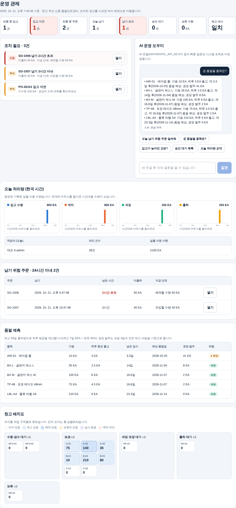
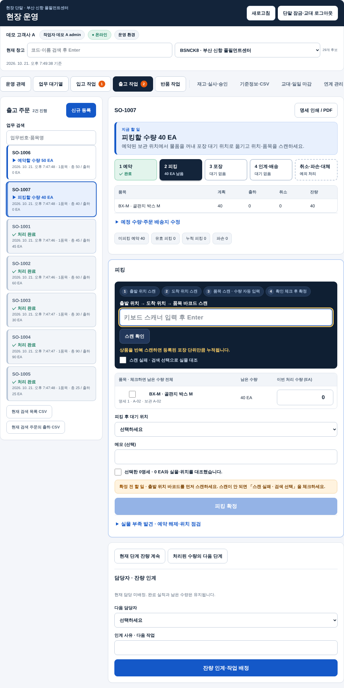
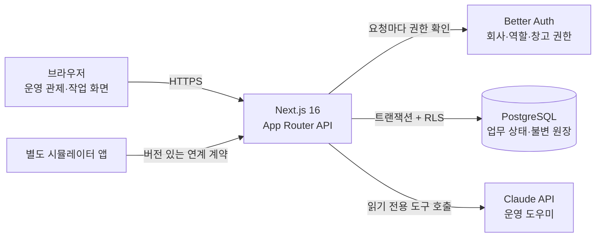

# WMS Lite — 창고 운영 관제 SaaS

여러 회사가 한 서비스에서 각자의 창고를 운영하는 **멀티테넌트 창고관리시스템(WMS)** 입니다. 오퍼레이터가 한 화면에서 창고 상황을 보고, 위험을 먼저 발견하고, 처리 화면으로 바로 이동하는 **운영 관제**를 중심으로 만들었습니다.

- 공개 데모: <https://wms-saa-s-platform.vercel.app/dashboard/v2> (계정은 [운영테스트 접속 안내](docs/운영테스트-접속안내.md) 참고)
- 사용자 매뉴얼: [전체 메뉴 (GPT 버전)](docs/WMS-현장운영-사용매뉴얼.md) · [현장 화면 요약 (Claude 버전)](docs/WMS-현장운영-사용매뉴얼-Claude.md)
- 학습 자료: [docs/학습자료](docs/학습자료/README.md) — 물류 기초부터 설계 결정, 면접 예상 질문까지



## 해결한 문제

| 현장 문제 | 시스템의 해결 방식 |
| --- | --- |
| 무엇이 급한지 사람이 직접 찾아야 한다 | **운영 관제**: 납기 초과·임박 주문, 입고 지연, 품절 예상, 승인 대기, 예약 차단 위치를 심각도 순으로 모으고 클릭하면 처리 화면으로 이동 |
| 재고가 장부와 실물이 어긋난다 | 모든 재고 변화를 **불변 원장**에 기록하고, 현재고와 원장을 대사. 수량을 자동 보정하지 않음 |
| 같은 확정이 두 번 반영된다 (통신 끊김·재시도) | 요청마다 **멱등 키**와 버전을 두고, 결과를 받지 못한 확정은 같은 키로 조회·재전송 |
| 회사 간 데이터가 섞이면 안 된다 | PostgreSQL **RLS(행 수준 보안)** 로 DB에서 회사 격리. 앱 계정은 RLS를 우회할 수 없음 |
| 작업자가 본인 실수를 스스로 승인한다 | 과납 인수·잔량 마감·실사 조정은 **다른 승인권자**만 확정 |
| 데이터를 보려면 화면을 여러 개 돌아다녀야 한다 | **AI 운영 도우미**: "오늘 납기 위험 주문 알려줘"를 자연어로 묻으면 읽기 전용 조회 도구를 호출해 답변 |

## 주요 기능

- **운영 관제**: KPI 8개, 조치 필요 목록, 시간대별 처리량(입고·적치·피킹·출하), 작업자별 실적, 납기 위험 주문, 품절 예측, 창고 배치도
- **AI 운영 도우미**: Claude API의 도구 호출(tool use)로 7가지 조회 도구를 실행합니다. 로그인한 회사·창고 권한 안에서만 조회하고 데이터는 바꾸지 않습니다. API 키가 없으면 빠른 질문을 시스템 조회로 바로 답합니다.
- **품절 예측**: 최근 28일 출하 원장으로 품목별 하루 소진량(최근 7일 60% + 28일 40%)을 계산하고, 남은 일수·예상 품절일·권장 발주량(조달 3일 + 안전재고 14일)을 제시합니다.
- **입고**: 예정 등록 → 수령 → 검수(정상·보류·파손) → 적치. 과납·미납·부분 수령과 잔량 마감을 지원합니다.
- **출고**: 주문 → 재고 예약 → 피킹 → 포장(최대 20명세) → 인계·출하 → 배송 상태 기록. 부족 시 부분 예약, 파손 격리와 대체 피킹을 지원합니다.
- **반품·실사·교대 마감**, 외부 시스템 연계(사건 접수·재처리), CSV 가져오기·내보내기, 계정 초대·역할·창고 권한



## 구조



| 영역 | 기술 |
| --- | --- |
| 화면·API | Next.js 16 (App Router), React 19, TypeScript |
| 인증 | Better Auth, 회사·역할·창고 단위 권한 |
| DB | PostgreSQL 17, RLS, node-pg-migrate (마이그레이션 22개) |
| AI | Claude API (`@anthropic-ai/sdk`, 도구 호출, 서버 측 거절 대체 모델) |
| 테스트 | Vitest(단위·DB 통합), Playwright(브라우저) — 로컬 `npm run verify` |
| 배포 | Vercel + Neon (공개 데모), Docker 구성 별도 제공 |

## 코드 둘러보기

| 경로 | 내용 |
| --- | --- |
| `src/app/dashboard/v2/control-ui.tsx` | 운영 관제 화면, 처리량 차트, AI 도우미 패널 |
| `src/server/v2/insights/` | 관제 지표·경고·품절 예측·배치도 계산(순수 함수)과 원장 집계 SQL |
| `src/server/v2/assistant/` | AI 도우미: 읽기 전용 도구 정의와 도구 호출 루프 |
| `src/server/v2/workflow/engine.ts` | 입고·출고·예약·피킹 상태 전이와 재고 버킷 규칙 |
| `src/server/v2/workflow/index.ts` | 트랜잭션·멱등 처리·원장 기록·대사 |
| `db/migrations/` | 스키마와 RLS 정책 |
| `tests/` | 단위·DB 통합·브라우저 테스트 |

## 실행

Node.js 24, Docker(또는 로컬 PostgreSQL 17)가 필요합니다.

```sh
npm ci
npm run env:init                      # .env.local 생성 (DB 암호·데모 비밀번호)
docker compose --env-file .env.local --profile test up -d --wait
npm run db:setup                      # 역할·마이그레이션·시드 계정
npm run dev                           # http://localhost:3000/dashboard/v2
```

AI 도우미의 자유 질문을 쓰려면 `.env.local`에 `ANTHROPIC_API_KEY`를 넣습니다. 없어도 관제 화면과 빠른 질문은 동작합니다.

검증은 GitHub Actions 없이 로컬에서 실행합니다. 개발 서버를 끈 뒤 `npm run verify`(타입 → 단위 → 시뮬레이터 → DB 통합 → 빌드 → 브라우저) 순서로 돌립니다.

## 문서

- [문서 안내](docs/문서-안내.md): 기획서·개발계획서·검증 기록을 읽는 순서
- [상세 README](docs/README-상세.md): 1차 MVP 기획 의도, 업무 규칙, 단계별 개발 기록
- [현장 운영 고도화 기획서](docs/WMS-현장운영-고도화-기획서.md) · [개발계획서](docs/WMS-현장운영-개발계획서.md) · [구현 추적표](docs/WMS-현장운영-구현추적표.md)

## 개발 방식

1인 기획·개발 프로젝트입니다. 기획서 → 개발계획서 → 구현 추적표 → 검증 결과 순서로 문서를 남기며, AI 코딩 에이전트(Claude Code, Codex)를 활용해 구현하고 사람이 업무 규칙과 검증 기준을 정했습니다. 가상 데이터 시험만 통과한 기능을 "실제 현장 검증 완료"로 표현하지 않습니다.
