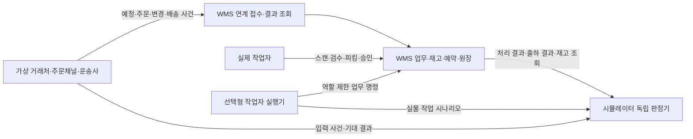

# WMS 현장 운영 고도화 기획서

**문서 버전:** v1.1 · 후속 개발계획 수립용 기획 기준안

**작성일:** 2026-10-20

**최종 개정일:** 2026-10-20 · 업무 규칙 3곳과 연속 작업 사용성 보강

**기준 제품:** WMS Lite 1차 MVP, 검증 기록 정리 커밋 `6608c4f`

**대상 산출물:** 현장 운영용 WMS v2 + 독립 가상 업무 데이터 앱(WMS 운영 시뮬레이터)

**문서 상태:** 제품 요구사항 정의. 아래 신규 기능은 아직 구현·검증되지 않았다.

이 문서는 [기존 기획서](WMS-Lite-프로젝트-기획서-초안.md)의 후속 기획이다. 기존 MVP의 완료 범위는 유지하고, 실제 창고에서 업무를 배정하고 처리하며 예외를 해결할 수 있는 다음 버전을 정의한다. 이후 작성할 개발계획서는 이 문서의 요구사항 ID와 수락 기준을 작업·설계·테스트에 연결한다. 여기서는 개발 일정, 공수, 담당 에이전트, 상세 DB 스키마를 확정하지 않는다.

## 1. 목표와 성공의 정의

### 1.1 제품 목표

> 입고예정부터 실물 수령·검수·적치, 주문 접수부터 예약·피킹·포장·출하, 반품과 재고 실사까지 이어지는 소규모 창고 운영을 관리한다. 별도 앱이 실제 거래처처럼 가상 업무를 보내고, 사람 또는 작업자 실행기가 이를 처리해 운영을 반복 검증한다.

현장 작업자가 “지금 무엇을, 어디서, 얼마만큼 처리해야 하는지” 알 수 있어야 한다. 관리자는 부족·오류·지연·승인 대기와 그 원인을 확인하고 조치해야 한다. 전표 등록뿐 아니라 미처리 잔량과 담당 업무를 관리하는 것이 이번 고도화의 중심이다.

### 1.2 완료 수준 구분

| 수준 | 의미 | 완료 판단 근거 |
| --- | --- | --- |
| 요구사항 구현 | 본 문서 필수 기능과 예외 규칙이 화면·API·DB에 반영됨 | 요구사항별 구현 및 자동 검사 |
| 모의 운영 통과 | 별도 앱과 WMS로 정상·혼잡·장애 시나리오를 반복 실행함 | 입력부터 최종 재고까지 독립 대사와 실행 보고서 |
| 현장 시범 운영 승인 | 실제 담당자가 실제 기기·업무 표본으로 검토하고 제한 운영을 승인함 | 업무 담당자 확인, 전환·복구 리허설, 운영 준비 |

가상 데이터 시험만 통과한 상태를 “실제 현장 검증 완료”라고 표현하지 않는다. 전체 필수 범위 중 남은 항목은 구현·로컬 검증·모의 운영·현장 확인 중 어느 단계가 남았는지 표시한다.

## 2. 대상 현장과 기획 가정

현재 실제 고객 인터뷰 결과는 없다. 다음은 개발 가능한 범위를 정하기 위한 기본안이며, 실제 현장 선정 후 확인한다.

| 항목 | v2 기준안 |
| --- | --- |
| 업종 | 산업 부품·포장재·생활 소모품 유통 창고, 상온 보관 |
| 소유 구조 | 서비스 고객사 한 곳이 자사 재고를 관리. 고객사=테넌트, 공급처·납품처는 고객사 내부 거래처 |
| 규모 | 회사별 창고 1~3개, 작업자 5~20명. 상세 시험 규모는 13장 기준 |
| 사용자 | 창고 관리자, 운영 책임자, 입고·출고 작업자, 조회자, 별도 연계 계정 |
| 기기 | PC·태블릿·모바일 브라우저, 키보드 입력 방식 USB/Bluetooth 바코드 스캐너 |
| 연결 | 온라인 작업 우선. 연결 단절 시 확정하지 않고 처리 결과 확인 후 재시도 |
| 수량 | 품목별 기준 단위는 정수 개. 고정 박스 포장은 정수 배수 환산만 지원 |
| 재고 특성 | LOT·유통기한·시리얼이 필수 아닌 품목을 시범 대상으로 제한 |
| 범위 경계 | 한 테넌트 안의 여러 화주 소유 재고를 다루는 3PL, 식품·의약품·냉장 및 제조 공정은 별도 기획 |

현장에 LOT·유통기한이 필수라면 이를 “나중 기능”으로 남긴 채 투입하지 않는다. 대상 현장을 바꾸거나 해당 요구를 필수 범위에 편입하고 기획 버전을 올린다.

## 3. 현재 제품과 달라지는 점

| 영역 | 현재 MVP에서 확인한 범위 | v2 신규 목표 |
| --- | --- | --- |
| 재고 반영 | 입고·출고·동일 창고 이동 전표 확정 | 실물 수령·상태 전환·적치·예약·피킹·출하 단계별 효과 |
| 업무 진행 | 초안·확정·취소·전체 반대 거래 | 예정/주문과 작업 분리, 부분 실적·잔량·담당자·예외 대기열 |
| 출고 도착지 | 거래처·주소록 선택과 확정 시 스냅샷 | 주문 납품처, 출하·포장 단위, 인계 및 외부 배송 사건 추적 |
| 기준정보 | 품목·창고·위치·최소재고 | 거래처, 바코드, 작업용 위치, 포장 단위, 입출고 정책 |
| 사용자 | 미리 생성한 관리자·작업자·조회자 | 관리자 계정 발급, 초대·중지·역할·창고 범위, 승인 분리 |
| 운영 검증 | 242개 로컬 검사, 공개 대표 업무·양방향 API 격리 | 다중 작업자·장시간·외부 사건·장애·전환을 포함한 운영 시험 |
| 외부 데이터 | 수동 입력·기존 시드 및 검증 스크립트 | 별도 앱이 정식 연계 계약으로 가상 업무를 공급 |

기존 단일 사용자 로컬 원장 1만 건 성능 측정과 로컬 별도 DB 복원은 출발 근거다. 다중 사용자 공개 운영 성능이나 실제 운영 제공자의 복구 목표를 이미 충족했다는 뜻은 아니다. [기존 검증 기록](기획서-잔여작업-검증결과.md), [공개 업무 검증](공개배포-검증결과.md), [격리 검증](공개환경-회사격리-검증절차.md)을 기준선으로 보존한다.

## 4. 제품 구성과 책임

**WMS**는 창고 작업·재고·예약·전표의 기준 시스템이다. **독립 시뮬레이터**는 가상 공급처·판매채널·운송사 역할과 시험 실행 관리를 담당한다. 별도 화면·프로세스·저장소·배포 설정을 가지며 WMS와는 버전이 있는 API 계약으로 통신한다. 같은 소스 저장소를 쓸지 별도 저장소를 쓸지는 개발계획서에서 정해도 되지만 실행과 데이터 소유권은 분리한다.

가상 공급처가 보낸 “100개 발송”은 입고 실적 100개가 아니다. 창고 작업자가 98개 수령했다고 기록하면 실물 기준은 98개다. 가상 운송사의 “배송 실패”도 창고 재고를 자동으로 되돌리지 않는다.

## 5. 범위와 요구사항 목록

우선순위 **필수**는 현장 시범 운영 버전의 완료 조건이다. **조건부 확장**은 현장 요건에 따라 추가하며 별도 버전으로 관리한다. 아래 ID는 후속 개발계획서·검증표에서 그대로 사용한다.

| ID | 필수 요구사항 | 주요 수락 근거 |
| --- | --- | --- |
| IAM-01 | 회사·창고·역할별 권한과 계정 발급·초대·중지 | 6장, AC-14·18 |
| IAM-02 | 승인 분리, 계정·연계 키 회수, 작업 이력 추적 | 6장, AC-10·14·18·21 |
| MD-01 | 공급처·납품처·배송지·위치 유형·활성 상태 관리 | 참조된 기준정보 삭제 방지, 검색 선택 |
| MD-02 | 품목/위치/포장 단위 바코드와 정수 환산 | AC-11 |
| MD-03 | 기준정보·예정·주문 CSV 검증·가져오기와 데이터 내보내기 | 8.1장, AC-19 |
| IN-01 | 입고예정 접수·수정·취소·부분수령·잔량마감 | AC-01·02 |
| IN-02 | 실물 수령, 검수 정상/보류, 과납·미납·파손 예외 | AC-01·02·21 |
| IN-03 | 분할 적치, 추천 후보·작업자 위치 확인 | AC-02 |
| OUT-01 | 주문 접수·수정·취소·납기·미처리 잔량 | AC-05·06·12 |
| OUT-02 | 위치별 예약·부족대기·명시적 부분예약 | AC-03·04 |
| OUT-03 | 작업 배정·피킹·부분 실적·오스캔·부족·파손 재작업 | AC-04·06·11·23 |
| OUT-04 | 포장 검수·포장별 수량·출하 단위·인계 확정 | AC-05·22·23 |
| OUT-05 | 인계 후 배송 상태·실패 기록, 재고와 분리 | AC-07·12 |
| INV-01 | 보관·가용·예약·피킹·검수/적치대기·보류 구분 | 7장, AC-01~10·21·23 |
| INV-02 | 보충을 포함한 동일 창고 이동·보류/해제 | AC-04·08·23 |
| INV-03 | 위치 실사·재계수·차이 승인·조정 원장 | AC-10 |
| RET-01 | 원출하에 연결된 고객 반품 수령·검수·적치 | AC-07 |
| COR-01 | 후속 작업을 고려한 취소·정정·보상 실적 | AC-06·08·09 |
| UX-01 | 역할별 작업 대기열, 스캔 흐름, 오류 복구, 검색 | 9장, AC-11·15 |
| OPS-01 | 예외 대시보드·감사·추적·출력/내보내기 | 9장, AC-15 |
| OPS-02 | 교대 인수인계·일일 업무 마감과 미처리 대사 | 9장, AC-20 |
| INT-01 | 회사별 연계 인증·외부번호 유일성·생성 멱등성 | 11장, AC-12·14 |
| INT-02 | 사건 revision·중복·순서역전·오류·결과 조회 | 11장, AC-12·13 |
| SIM-01 | 독립 앱의 가상 공급처·주문·운송 사건 생성 | 10장, 운영 시나리오 T01~T12 |
| SIM-02 | 사람 참여/자동 작업 모드, seed·실행 이력·재개 | 10장, AC-13·15 |
| SIM-03 | 독립 기대값 계산, 처리 경계 대사, 증거 보고서 | 12장, AC-13 |
| RUN-01 | 실제 배포 환경의 모니터링·백업·복구·지원 절차 | 14장, AC-16 |
| MIG-01 | 기존 계정·전표·원장 보존, 전환 대사·리허설 | 15장, AC-17 |

**이번 버전에서 제외할 범위:** LOT/FEFO·시리얼, 중량/길이/가변 포장 환산, 창고 간 이동 중 재고, 웨이브·다주문 합포장·자동 배치 최적화, 공급처 반품 전용 프로세스, 실제 ERP/쇼핑몰/택배사 계약 연동, 전용 PDA 앱·오프라인 확정, 자동화 설비, 회계·원가·정산·구독 결제, AI 예측·조회 도우미. 내부 포장명세 출력과 가상 배송 사건은 필수지만 실제 택배 운송장 발급은 제외한다.

## 6. 사용자와 권한

| 역할 | 주요 업무 | 제한 |
| --- | --- | --- |
| 회사 관리자 | 회사 내부 사용자·창고 접근 범위, 기준정보, 연계 설정 | 타사 접근 금지. 본인이 요청한 재고 조정·과납 승인은 불가 |
| 운영 책임자 | 작업 배정·예외 처리·실사 조정 승인·과납/잔량마감 승인 | 계정·연계 키 관리 권한 없음 |
| 작업자 | 허용 창고의 수령(초과 도착분 보류 기록 포함)·검수·적치·피킹·포장·인계·실사 입력 | 재고 조정·과납 승인·승인 전 정상 적치/가용 전환·자기 승인·과거 실적 삭제 금지 |
| 조회자 | 허용 창고의 현황·확정 이력·보고서 조회 | 초안·작업 변경·관리 설정 접근 금지 |
| 연계 계정 | 지정 회사의 예정·주문·배송 사건·반품 요청 및 자신의 처리 결과 | 창고 실물 확정·재고 조정·사용자 관리 금지. 기준정보 쓰기는 별도 준비 권한 |
| 자동 작업 계정 | 시험 회사에서 허용된 작업자/승인자 동작 | 실제 운영 회사 사용 금지, 일반 작업자와 동일 업무 검증 |

- `IAM-01`: 사용자는 한 회사 소속을 유지하며 회사 내 허용 창고를 지정한다. 회사 관리자도 명시된 관리 범위 안에서만 동작한다. API·검색 후보·집계·다운로드·인쇄·배경 작업까지 같은 권한을 적용한다.
- 플랫폼 운영자는 최초 회사와 회사 관리자 발급을 감사 가능한 별도 운영 경로로 처리한다. 일반 사용자가 테넌트 ID를 임의 입력해 회사를 생성하거나 이동할 수 없다. 공개 자가 가입은 범위 밖이다.
- 회사 관리자는 초대 링크 발급·취소·재발급, 유효기간, 최초 비밀번호 설정, 계정 중지·역할 변경을 관리한다. 초대/재설정 토큰은 일회성이며 비밀번호를 관리자에게 표시하지 않는다. 이메일 발송 서비스가 미선정이면 관리자 전달 방식의 일회 링크를 시범 기본안으로 사용한다.
- 초대는 회사·이메일에 묶고 재발급 시 이전 링크를 폐기한다. 계정 상태는 초대대기/활성/일시중지/퇴사로 구분한다. 마지막 회사 관리자를 중지하기 전에 후임 관리자를 지정해야 하며, 퇴사자의 과거 작업자 표시는 보존한다.
- 계정·역할·창고 권한이 회수되면 기존 세션의 다음 보호 요청에서 차단한다. 연계 키는 회사·원천 시스템·허용 사건·환경에 묶고 만료·교체·회수 이력을 남긴다.
- `IAM-02`: 조정·과납 인수·예정 잔량마감은 다른 승인권자의 승인이 필요하다. 초과 도착분을 보류 재고로 기록하는 데에는 사전 승인을 요구하지 않는다. 시범 운영 회사에는 승인 가능한 사용자 2명 이상을 둔다. 사람이 한 명인 환경은 이 승인 시험을 통과한 것으로 처리하지 않는다.
- 승인 요청에는 수량·위치·사유·대상 버전을 고정한다. 수정하면 이전 승인은 무효다. 승인 확정 시 현재 권한·잔량·잠금을 재검사하고 해당 승인 대상 효과와 이력을 원자적으로 반영한다. 과납 승인만으로 적치까지 완료하지는 않는다. 반려는 재고 효과 없이 사유를 남긴다.
- 공용 단말에는 현재 회사·창고·작업자를 표시한다. 교대 시 로그아웃·인계를 수행하고 이전 사용자의 임시 입력·캐시를 다음 사용자에게 노출하지 않는다. 자동 잠금 시간은 현장 운영 설정으로 관리한다.
- 모든 실적에는 회사·창고·작업자 또는 서비스 계정·업무 객체·요청 ID·원본/정정 관계·사유·서버 처리 시각을 기록한다. 개인정보·암호·토큰·요청 원문 전체는 운영 로그에 저장하지 않는다.

## 7. 재고와 수량의 공통 규칙

### 7.1 실물과 예약의 정의

| 기호 | 정의 |
| --- | --- |
| S | 정상 보관 위치에 적치된 출고 가능 품질의 실물 수량. 예약된 수량도 포함 |
| R | S 중 주문에 예약됐으나 아직 피킹되지 않은 수량 |
| P | 피킹 후 포장/출하대기 위치에 있는 실물. 포장 완료분은 P의 일부 |
| Q | 수령·반품 후 검수대기 또는 정상 판정 후 적치대기 수량 |
| B | 불량·파손·격리·출고금지 등 보류 실물 수량 |
| A | 예약 가능한 위치에서는 `S − R`, 실사·점검으로 차단된 위치에서는 0. 창고 가용수량은 위치별 A의 합계 |
| H | 창고 안 실물 총재고: `S + P + Q + B` |

S·P·Q·B는 같은 실물을 중복 계상하지 않는 분류다. 예약 R은 S에 포함된 업무 약속이며 실물 재고에 다시 더하지 않는다. 포장 수량 역시 P에 다시 더하지 않는다. 원장 합계 대사는 위치·품목·품질/작업 상태별 실물을 기준으로 하고, 예약 이력 대사는 별도로 수행한다. 상세 저장 구조는 개발계획서에서 정한다.

`0 ≤ R ≤ S`, `A ≥ 0`, 각 실물 수량은 음수가 될 수 없다. 품목·회사·창고·위치마다 규칙을 지키고 합계 화면에도 같은 정의를 적용한다. 검수/적치대기·보류·출하대기·실사 잠금 위치에는 신규 예약을 만들지 않는다. 아래 수량 예시는 별도 명시가 없으면 예약 가능한 위치를 전제로 한다. 위치 잠금은 S/H를 줄이지 않으며, 가용에서 제외된 사유와 수량을 화면에서 확인할 수 있다.

### 7.2 재고 효과의 발생 시점

| 동작 | 실물/예약 효과 |
| --- | --- |
| 예정·주문 접수, 도착 통보 | 실물 증감 없음 |
| 실제 수령 확정 q | 예정 범위 수량은 Q, 미승인 초과 도착분은 B에 기록. Q/B 증가 합계 q만큼 H 증가 |
| 과납 인수 승인/반려 | 이미 수령한 초과분의 승인 상태만 변경. S/Q/B/H/A 불변 |
| 인수 승인된 과납의 보류 해제 q | 실물 위치 확인 후 B → 검수대기 Q, H/A 불변. 검수·적치는 별도 확정 |
| 정상 판정 | 검수대기 Q → 적치대기 Q, H 불변 |
| 보류 판정 q | Q → B, H 불변 |
| 정상 적치 q | Q → S, H 불변, A 증가 q |
| 예약 q | R 증가 q, A 감소 q, H 불변 |
| 피킹 q | S 감소 q, R 감소 q, P 증가 q, H 불변 |
| 포장 | P 안의 포장별 연결만 변경, H 불변 |
| 실제 인계·출하 q | P 감소 q, H 감소 q |
| 미피킹 예약 해제 q | R 감소 q, A 증가 q, H 불변 |
| 피킹물 실물 반납 q | 확인한 위치로 P → S 또는 B, H 불변 |
| 주문을 유지하는 피킹물 파손 격리 q | P → B와 해당 수량의 주문 피킹 점유 해소를 함께 처리. H 불변, 주문량/취소량 불변, 대체 필요량 q 증가 |
| 고객 반품 실물 수령 q | Q 증가 q, H 증가 q. 정상 판정·적치 전 A 불변 |
| 실사 조정 | 승인한 차이만 S/Q/B 등 대상 실물과 조정 원장에 증감 |

분실·폐기는 승인된 음수 조정과 사유로 처리한다. 배송 실패·주문 취소 버튼만으로 출하된 물건을 재고에 더하지 않는다. 이동과 품질 전환은 출발 감소·도착 증가를 함께 확정해 H를 보존한다.

### 7.3 수량·원자성·불변 이력

- 기준 수량은 정수 개다. 박스 바코드는 등록한 정수 포장 수량을 개로 변환한다. 예: 1BOX=12EA, 2BOX=24EA. 품목별 환산값·입력 단위·기준수량을 실적에 보존한다. 과거 실적의 환산값을 기준정보 변경으로 다시 계산하지 않는다.
- 한 바코드의 품목·포장수량은 재할당하지 않는다. BOX12를 BOX10으로 바꿀 때는 새 포장규격과 바코드를 발급한다. 기존 라벨과 진행 중 작업은 기존 환산값을 유지한다.
- 전표/작업 한 번의 확정은 선택한 모든 명세가 함께 성공하거나 함께 실패한다. 부분처리는 사용자가 선택한 수량으로 새로운 실적을 만드는 것이며 서버가 임의로 일부만 성공시키지 않는다.
- 예정/주문 품목행은 최대 100개를 기준으로 하고, 실제 처리 작업 한 건은 최대 20명세로 분리한다. 같은 품목이 여러 위치에 나뉠 수 있으며 위치별 작업명세를 구분한다. 포장 하나의 출하에 필요한 명세도 최대 20개이며 선택한 여러 포장을 한 번에 출하할 때는 명세 합계가 20개 이하여야 한다. 8.4장의 같은 계산 기준을 포장 확정 전과 출하 확정 전에 모두 적용한다.
- 중복 키·같은 내용은 원래 결과를 반환한다. 중복 키·다른 내용은 충돌로 거절한다. 다른 키로 반복해도 잔량을 넘는 수량은 거절한다. 예외는 8.2장의 **초과 도착분 보류 수령 기록**이며 정상 입고·적치의 잔량 제한을 우회하는 용도로 쓸 수 없다. 같은 실물 수령 건·명세는 하나의 수령 식별자로 추적해 다른 요청 키를 써도 중복 확정하지 않는다. 실제 추가 도착분은 별도 수령 건으로 구분한다. 생성부터 확정·조정까지 중복 방지를 적용한다.
- 확정 실적·원장·감사 이력은 수정/삭제하지 않는다. 정정은 원본에 연결한 새 실적과 사유로 남긴다. 단순 수량 덮어쓰기·직접 DB 초기화는 업무 기능이 아니다.
- 실제 처리 시각은 서버 기준이며 외부 발생시각·예정일과 분리한다. 업무일 집계와 표시는 Asia/Seoul 기준으로 정의하고 취소/반품은 발생한 업무일의 별도 실적으로 표시한다.

## 8. 업무 흐름과 예외 처리

### 8.1 기준정보와 위치 (`MD-01~02`)

품목에는 코드·명칭·검색어·기준단위·포장단위·단위별 바코드·최소 가용재고·사용 여부를 둔다. 동일 회사 내 품목 바코드는 하나의 품목/단위만 가리킨다. 공급처와 납품처는 역할을 구분하되 한 거래처가 두 역할을 가질 수 있다. 주소록은 담당자·연락처·우편번호·주소·사용 여부와 외부 코드를 관리한다.

위치는 창고에 소속되며 수령대기·보관·피킹/포장대기·출하대기·보류 유형을 가진다. 입고와 피킹에는 출발/도착 위치 후보를 제한한다. 추천 적치 위치는 고정 우선 위치와 현재 후보만 제공하며 자동 최적화나 자동 확정은 하지 않는다. 실물·예약·미완료 작업이 남은 기준정보는 비활성화하거나 다른 창고로 옮길 수 없다. 재출력한 라벨은 같은 식별자를 유지한다.

CSV는 품목·위치·거래처·배송지·입고예정·주문의 일괄 입력을 지원한다. 양식·필수 열·단위·허용 코드·최대 행 수를 안내한다. 업로드 → 형식/참조/중복 검사 → 오류 행 다운로드 → 정상 행 선택 적용으로 나누고, 행별 결과와 재전송 키를 유지한다. 재고 수량 CSV 덮어쓰기는 제공하지 않는다. 외부 입력 텍스트는 내보내기 시 스프레드시트 수식으로 실행되지 않도록 처리한다.

재고·전표·원장·기준정보 내보내기는 회사·창고·필터·기준 시각·단위·상태·원본/정정 연결을 포함한다. 여러 페이지에 걸친 결과에도 누락·중복 없는 조회 경계를 사용한다. 내보낸 업무 파일을 DB 백업으로 취급하지 않는다.

### 8.2 입고예정·수령·검수·적치 (`IN-01~03`)

1. 공급처·예정일·품목·예정수량·외부번호를 등록한다. 상태는 접수/진행/완료/잔량마감/취소이며 행별 수령·미수령·승인 과납을 표시한다.
2. 작업자가 차량·납품서와 예정 건을 찾아 실제 수량을 기록한다. 예정 범위는 수령대기 Q로, 초과 도착분은 사유와 함께 보류 위치 B로 나눠 확정한다. 한 수령 건의 Q/B 실적과 H 증가는 함께 성공하거나 함께 실패하며, 실제 수령할 때 한 번만 반영한다.
3. 정상·보류·파손 수량을 판정한다. 판정 합계는 수령 수량을 넘을 수 없고 미판정 잔량을 남길 수 있다.
4. 정상 판정분만 보관 위치에 분할 적치한다. 바코드로 품목과 도착 위치를 확인하고 적치 실적을 남긴다.
5. 미납 잔량은 후속 수령을 기다리거나 사유·승인으로 마감한다. 초과 도착분의 인수는 기록한 작업자와 다른 승인권자가 판단한다. 승인 전에는 정상 적치·예약·가용 전환을 금지한다. 승인은 이미 기록된 초과분에만 적용하며 새로운 추가 수령 잔량을 만들지 않는다.

예정 100개에 실제 105개가 도착했다면 수령 직후 `Q=100, B=5, H=105, A=0`으로 표시한다. 예정 미수령은 0, 미승인 초과 도착분은 5로 구분하며 미수령을 음수로 표시하지 않는다. 작업자는 이 실물 기록을 할 수 있지만 스스로 과납 인수를 승인할 수 없다.

과납 승인만으로 H를 다시 더하거나 B를 가용으로 바꾸지 않는다. 승인된 수량은 보류 해제·실물 위치 확인으로 검수대기 Q에 옮긴 뒤 정상 검수·적치를 거친다. 품질 보류 사유가 남은 수량은 B에 유지한다. 반려된 수량도 실물이 있는 동안 B/H에 남으며, 실제 반송·승인 폐기 등 후속 실적 없이 삭제하거나 차감하지 않는다.

수령되지 않은 예정만 취소할 수 있다. 일부 수령된 예정은 미수령 잔량만 취소/마감한다. 실물 수령 후 반송·분실을 단순 예정 취소로 처리하지 않는다. 공급처 반송이 필요한 시범 현장은 v2의 승인 출고 조정과 인계 기록으로 처리할지 공급처 반품 전용 기능을 편입할지 현장 확인 후 정한다. 기록 없이 현장 밖으로 내보내는 방식은 허용하지 않는다.

### 8.3 주문·예약·피킹 (`OUT-01~03`)

주문은 고객사 내부 납품처·배송지·요청 납기·외부번호·품목행으로 구성한다. 행마다 `주문량 = 취소량 + 누적 출하량 + 미출하량`을 지킨다. 예약과 피킹은 미출하량 안의 진행 단계다. 반품은 누적 출하를 지우지 않는 별도 실적이다.

- 주문 상태는 접수/진행/완료/잔량마감/취소로 단순화하고 예약·피킹·포장·출하 수량을 별도 표시한다. 같은 주문에 출하완료분과 부족 대기분이 동시에 존재할 수 있다.
- 작업·예약이 없는 최초 접수 단계에서는 수량 수정 이력을 남긴다. 그 이후 축소는 원주문량을 보존한 잔량 취소로 처리하고, 증량은 연결된 추가 주문으로 접수한다. 원주문량을 줄이는 동시에 취소량을 더해 보존식이 깨지지 않게 한다.
- 최초 예약은 요청한 수량 전체를 확보하는 방식이다. 부족하면 전체 예약을 실패시키고 부족량을 표시한다. 운영자가 “가능 수량만 예약”을 명시적으로 선택하면 선택 수량을 예약하고 나머지를 대기로 남긴다.
- 기본 배정은 납기, 주문 접수 시각, 고정 ID 순서다. 동일 품목의 위치 선택은 관리자가 정한 보관 위치 우선순위 후 위치코드 순이다. LOT 선입선출 정책으로 표현하지 않는다.
- 예약은 대상 재고와 주문 잔량을 함께 잠가 처리한다. 부족한 주문이 나중에 자동 예약되는 기능은 v2에서 운영자 재실행으로 제한하며, 몰래 일부 확보하지 않는다. 예약을 시간만으로 자동 해제하지 않고 장기 점유 경고와 책임자 해제 기능을 제공한다.
- 작업 배정은 담당자와 처리 가능한 창고를 확인한다. 담당자를 바꾸거나 교대할 때 완료 실적과 남은 작업을 보존한다. 두 사람이 같은 작업을 동시에 완료할 수 없다.
- 피킹은 원래 위치·품목·수량·이동할 대기 위치를 확인한다. 선택한 수량만큼 S/R이 감소하고 P가 증가한다. 오스캔은 재고를 변경하지 않는다.
- 추가 예약 가능량은 미출하량에서 현재 미피킹 예약·유효 피킹 점유·취소 대기 점유를 중복 없이 뺀 값이다. 포장 수량은 유효 피킹에 포함한다. 파손 격리로 해소된 피킹은 과거 실적에 보존하지만 현재 점유에서 제외한다. 누적 피킹량이 원주문량을 넘었다는 이유만으로 정당한 대체 피킹을 거절하지 않는다.
- 실물 부족을 발견하면 확인 수량까지만 명시적 부분피킹하고 부족 예약을 해제하거나 재배정 대기로 돌린다. 부족 위치를 먼저 신규 예약 차단 상태로 전환해 의심 수량의 재배정을 막는다. 장부 수량은 자동 차감하지 않으며 해당 위치의 점검/실사를 요청한다.

### 8.4 포장·출하·배송 (`OUT-04~05`)

포장은 한 주문에 속하며 주문 사이의 합포장은 제외한다. 한 주문은 여러 포장·출하 차수를 가질 수 있다. 포장마다 고유번호, 담긴 품목·기준수량, 무게 선택값, 배송지 스냅샷과 내부 포장명세를 기록한다. 포장 확정 전에 피킹 실적과 수량이 맞는지 검수한다.

**포장·출하 명세 한도:** 한 명세는 포장번호·원주문행·품목·피킹 실적 명세·현재 출하대기 위치가 같은 배분 수량이다. 같은 조합은 한 명세로 계산하되 원주문행·피킹 출처·위치·포장 중 하나라도 다르면 구분한다. 화면에 같은 품목의 수량을 합산해 보여주더라도 원행·출처 연결과 실제 처리 명세수는 유지한다.

- 포장 하나를 전체 출하할 때 필요한 명세는 최대 20개다. 21명세 이상이면 포장 확정 전에 초과 수와 분할 안내를 표시한다. 확정 후 재포장/내용 변경에도 같은 기준을 검사한다.
- 여러 완료 포장을 선택하면 포장별 명세를 모두 펼친 합계를 검사한다. 12명세 포장과 9명세 포장은 각각 출하할 수 있지만 함께 21명세로 확정할 수는 없다. 재고 효과 없이 선택 조정·별도 출하를 안내한다.
- 포장 개수나 SKU 종류수만으로 한도를 계산하거나 서로 다른 포장의 명세를 합쳐 한도를 우회하지 않는다. 시스템이 임의로 포장을 쪼개거나 일부 출하를 먼저 확정하지 않는다. 더 큰 포장이 필요하면 개발계획에서 포장·출하 한도와 검증 기준을 함께 개정한다.

**포장 검사 중 파손 발견:** 해당 수량을 출하 대상에서 차단한다. 이미 포장 완료한 경우 먼저 포장을 해제한다. 책임자가 영향 주문을 확인하고 파손품의 보류 위치 이동과 해당 수량의 유효 피킹 점유 해소를 함께 확정한다. `P → B`로 H는 유지하고 주문량·취소량·미출하량은 바꾸지 않는다. 남은 정상 피킹물은 유지하며 부족한 수량만 같은 주문에 다시 예약·피킹한다. 대체 재고가 없으면 부족 대기로 남기고, 충분하면 교체 후 포장·출하를 계속한다. 파손 격리·대체 피킹·포장은 원피킹과 연결해 이력을 보존한다.

출하는 선택한 **완료 포장 전체**를 차량/운송사에 실제 인계할 때 확정한다. 포장 일부만 출하하려면 먼저 포장 해제·분할을 처리한다. 단일 요청의 명세 하나가 실패하면 출하 전체가 실패한다. 인계자·운송수단/가상 운송사·인계시각·포장 목록을 남기고 그 순간에만 P와 H를 차감한다.

주문 주소 변경은 미포장 잔량에만 기본 반영한다. 포장 완료분은 포장 해제·재확인이 필요하고 인계 완료 스냅샷은 변경하지 않는다. 배송 상태는 인계/운송중/배송완료/실패/분실 및 정정 이력으로 관리한다. 외부 사건이 먼저 도착하거나 늦게 도착해도 출하 실적을 자동 생성하거나 이미 완료된 상태를 무조건 이전으로 덮어쓰지 않는다.

### 8.5 취소·반품·정정 (`RET-01`, `COR-01`)

| 진행 단계 | 허용 처리 |
| --- | --- |
| 미예약 잔량 | 취소 가능, 재고 불변 |
| 예약 후 미피킹 | 취소 수량의 예약 해제와 주문 취소를 함께 처리 |
| 피킹 후 미포장 | 취소 요청을 대기시키고 실제 반납 확인 후 예약/작업 해소 |
| 포장 완료·미인계 | 포장 해제 → 실제 반납 확인 → 취소. 반납 전 가용 증가 금지 |
| 인계·출하 완료 | 일반 주문 취소 금지. 고객 반품 요청과 실물 반품 처리 |

취소 대기 수량은 신규 포장·출하에서 제외한다. 취소 접수와 출하가 경합하면 먼저 확정된 상태를 기준으로 후속 요청을 검사한다. **주문 취소를 위한 반납** 완료 시에만 취소량을 증가시키고 미출하량을 같은 만큼 줄인다. 주문을 유지하는 파손 격리·대체 피킹은 이 취소 경로를 사용하지 않는다.

고객 반품은 원출하·품목·요청/승인/수령/검수/적치 수량을 연결한다. `추가 승인 가능량 = 원출하량 − 누적 반품수령량 − 유효 승인 건의 미수령 잔량 합계`로 중복 반품을 막는다. 미수령 잔량은 사유·처리자를 기록해 철회/마감하고 승인 점유를 해제할 수 있다. 반품 요청만으로 재고를 증가시키지 않고 수령한 수량을 Q로 기록한다. 판정 후 정상분은 적치하여 S로, 재판매 불가분은 B로 전환한다. 재배송은 별도 주문으로 원주문·반품에 연결한다.

기존 MVP의 전체 역분개는 입력 오류를 되돌리는 경로다. v2의 물리적 출하 취소를 대신하지 않는다. 예약·후속 작업·이동·반품이 연결된 실적은 직접 되돌리지 않고 선행 관계와 실물 위치를 검사한다. 가능한 정정은 책임자 사유와 연결 실적으로 처리하고 불가능한 경우 필요한 선행 조치를 안내한다.

### 8.6 이동·보류·실사 (`INV-02~03`)

동일 창고 내부 이동과 피킹 위치 보충은 실물 양쪽 수량을 동시에 변경한다. 예약 수량을 임의 위치로 옮기지 않는다. v2 기본안은 해당 예약을 먼저 재배정/해제한 뒤 이동하는 방식이다. 보류 전환도 예약·피킹 점유가 있으면 책임자가 영향을 받는 수량의 점유를 해소해야 한다. 8.4장의 파손 재작업은 피킹 점유 해소와 P→B 이동을 함께 처리하는 경로이며 주문 자체를 취소하지 않는다. 이 절차 밖에서 점유된 실물만 임의로 보류 전환할 수 없다. 보류 해제는 사유와 판정자를 남긴다.

실사는 한 위치를 단위로 시작한다. 해당 위치의 진행 중 피킹·이동을 완료하거나 중단/재배정하고, 예약을 해소한 뒤 실사 잠금을 획득한다. 시작 조건 검사와 잠금 획득은 신규 예약과 경합해도 원자적으로 수행한다. 잠긴 위치의 신규 예약·수령·적치·피킹·이동·상태 변경은 막되 다른 위치 작업은 계속한다.

계수자는 장부 수량을 보지 않고 입력하는 모드를 기본으로 사용한다. 차이가 있으면 재계수와 사유를 요구하고 다른 승인권자가 조정한다. 승인 시 장부 기준 버전과 실사 잠금이 유효해야 하며, 조정 원장·수량 반영·잠금 해제를 함께 처리한다. 승인 거절은 수량을 바꾸지 않는다. 잠금이 강제 해제된 실사는 기존 계수값으로 승인할 수 없고 재계수를 요구한다. 출하대기 P 위치는 v2 정기 실사 대상에서 제외하고, 미출하 작업 해소 후 별도 확인하도록 제한한다.

## 9. 화면·작업 경험·운영 현황 (`UX-01`, `OPS-01`)

| 화면 | 현장 사용 목적 |
| --- | --- |
| 업무 홈 | 입고 지연·부족 주문·피킹/포장 대기·승인·연계 오류를 클릭해 해결 |
| 입고 작업 | 예정 검색 → 수령 → 미판정 검수 → 미적치 수량과 담당자 확인 |
| 출고 작업 | 주문·잔량·예약·작업 배정·피킹·포장·출하를 구분 |
| 스캔 작업 | 작업 선택 후 위치→품목→수량 확인, 결과와 다음 동작을 크게 표시 |
| 재고 | H/S/A/R/P/Q/B, 위치·품목·상태·연결 주문·원장 추적 |
| 반품·실사·승인 | 요청/처리/대기 사유, 요청자와 승인자, 정정 근거 |
| 연계 관리 | 원천 시스템별 접수·반영·거절·대기·재처리와 원문 요약 |
| 사용자·기준정보 | 계정 발급/중지, 역할/창고, 거래처·바코드·위치 관리 |

**같은 작업자의 연속 처리:** 수령 결과에서 검수·적치로, 피킹 결과에서 포장·출하로 바로 이어갈 수 있게 한다. 같은 업무번호·품목을 다시 검색하지 않고 현재 작업·처리 실적·다음 단계 가능 수량을 전달한다. 일부만 처리하면 `현재 단계 잔량 계속`, `처리된 수량의 다음 단계`, `다른 작업자에게 인계`를 구분해 선택할 수 있고 완료분·잔량·다음 작업을 같은 업무 화면에서 확인한다. 인계받은 작업자도 완료분과 남은 작업을 그대로 이어받는다.

이동한 화면은 현재 권한·담당자·업무 버전·잔량을 다시 확인한다. 화면 이동은 업무 확정이 아니며 수령·검수·적치·포장·출하의 확인 조건, 필요한 품목/위치 스캔, 명시적 확정과 개별 이력을 유지한다. 승인 대기·권한 부족·결과 미확인으로 진행할 수 없으면 이유와 다음 조치를 같은 흐름에서 안내한다. 사용성 시험에는 불필요한 재검색·중복 입력·화면 왕복, 잔량 오해·도움 요청과 개선사항을 기록한다.

작업자는 기본 업무 중 UUID·멱등키·DB 오류명을 입력하지 않는다. 스캔 실패 시 검색 선택을 허용하되 대체 입력 사유를 남기고 품목·위치 대조를 건너뛰지 않는다. 정상 연속 스캔과 네트워크 재전송을 구별한다. 같은 상품을 두 번 스캔하면 수량 2일 수 있으므로 바코드 값 자체를 중복요청 키로 사용하지 않는다.

연결이 끊기면 “미전송/처리 중/결과 확인 필요/완료”를 구분한다. 결과 미확인 작업에는 새 키를 생성해 재확정하지 않는다. 오프라인 동안 임시 입력은 가능해도 재고가 반영됐다고 표시하지 않는다. 앱 재시작 후 남은 작업과 미확인 요청을 복구한다.

라벨·피킹리스트·포장명세는 브라우저 인쇄/PDF를 지원한다. 인쇄 실패·재출력은 재고 효과가 없고 출력 당시 버전을 표시한다. 운영 지표는 처리량·작업 대기시간·납기 초과·미납·품절·오피킹·실사 차이·연계 처리 지연을 정의하고 분모와 집계 시각을 공개한다. 화면과 내보내기의 회사·창고 필터가 일치해야 한다.

`OPS-02`: 교대/일일 마감에서는 미수령·미적치·미피킹·미출하·승인 대기·결과 미확인을 대조하고, 남은 작업마다 다음 담당자와 사유를 기록한다. 현재고↔원장 대사와 실사↔장부 차이를 구분한다. 마감 보고서는 기준 시각의 결과이며 미처리 건을 자동 완료하거나 뒤늦은 실적을 과거 날짜로 덮어쓰지 않는다. 정정은 현재 업무일의 연결 실적으로 남긴다.

## 10. 별도 앱: WMS 운영 시뮬레이터 (`SIM-01~03`)

### 10.1 사용자와 주요 화면

운영 시험 담당자가 시나리오를 선택하고 시작·일시정지·재개·종료한다. 실제 창고 담당자는 사람 참여 모드로 WMS에서 작업하고, 개발/검증 담당자는 자동 모드로 반복 실행한다.

별도 앱에는 다음 화면을 둔다.

- **시험 연결:** 대상 WMS 주소·시험 환경 표시·연결 시스템·시험 회사 범위·연결 확인. 비밀값은 화면 재표시/로그/보고서에서 제외.
- **가상 거래처:** 공급처·납품처·품목 대응·주문/입고 패턴·배송 사건 규칙.
- **시나리오 편집:** 사건 수·수량 분포·납기·근무시간·부족/파손/중복/지연 비율·seed.
- **실행 제어:** 생성·미발송·결과 미확인·반영·업무 거절·기술 실패·격리 건수, 일시정지/재개.
- **작업자 모드:** 사람 참여/자동 작업 선택, 작업자 수·역할·속도·오스캔·교대·중단 행동.
- **타임라인·판정:** 외부 사건→WMS 접수→작업 실적→출하→반품 연결, 기대/실제 차이와 재현 조건.
- **시험 보고서:** 버전·조건·결과·미실행·복구·정리 결과 다운로드, 실행 간 비교.

### 10.2 데이터 소유와 시험 방식

| 모드 | 외부 사건 | 창고 작업 | 주요 검증 |
| --- | --- | --- | --- |
| 사람 참여 | 앱이 예정·주문·배송 사건 공급 | 실제 사용자가 WMS 조작 | 화면 사용성·장비·예외 처리 |
| 자동 반복 | 같은 외부 계약 사용 | 별도 작업 계정이 정식 업무 명령 실행 | 재고·예약·멱등·장시간·경합 |
| 혼합 | 외부 사건 자동 | 정상 작업 자동, 예외·승인은 사람 처리 | 운영 대기열·인수인계·승인 흐름 |

외부 공급 계정과 작업자 계정은 분리한다. 자동 작업은 `simulated_worker` 등 식별 가능한 주체로 감사 기록을 남기며 승인자는 요청자와 별도다. 시뮬레이터가 회사·사용자를 스스로 생성하거나 DB 관리자 권한을 갖지 않는다. 시험 회사·계정·연계 키는 WMS의 승인된 준비 절차로 발급한다.

혼합 모드는 작업별 담당자·점유·버전을 관리한다. 자동→사람 이양 시 자동 명령을 중지하고 미확인 요청의 결과를 확인한 뒤 넘긴다. 사람→자동 재개도 명시적으로 선택한다. 실제 운영자 계정을 자동 작업 계정으로 재사용하지 않는다.

품목·거래처는 별도 기준정보 준비 권한으로, 예정·주문은 외부 공급 권한으로 API에 초기 공급한다. 기본 외부 공급 키에는 기준정보 쓰기 권한을 부여하지 않는다. 초기 재고 역시 수령·검수·적치 흐름으로 만든다. 직접 DB 대량 적재는 별도의 조회 성능 시험에만 사용할 수 있고 운영 흐름 통과 근거로 계산하지 않는다.

### 10.3 재현·재개·초기화

- 실행마다 `run_id`, 시나리오 버전, 생성기 버전, seed, 초기 조건, WMS/연계 계약 버전, 대상 환경과 처리 범위를 저장한다.
- 정확 재생 모드는 사건 순서와 처리 결과 확인 순서를 고정한다. 부하 모드는 경합 순서가 달라질 수 있으므로 동일 seed가 동일 승자를 보장한다고 하지 않고 허용 결과 집합을 정의한다.
- 가상시계는 예정·사건 생성만 가속한다. 서버 실제 처리시각·권한 만료·업무일 집계·재시도 지연을 임의 변경하지 않는다. 업무일 경계 시험은 지정한 시험 경계 또는 격리된 시험용 시계 계약으로 따로 검증하며 실제 서비스 시계를 바꾸지 않는다.
- 발송 전 사건과 키를 영속화한다. 재시작 후 결과 미확인 사건은 같은 ID·본문으로 결과를 조회/재시도한다. 새 사건으로 바꾸어 누락을 감추지 않는다.
- 일시정지는 사건 공급과 자동 작업 실행기를 각각 멈추고 진행 중 요청이 정리된 지점을 보여준다. 사람의 작업 중지 여부도 표시하며 대사 전에는 해당 범위의 모든 변경을 멈추거나 같은 처리 커서를 확보한다. 강제중단은 미확인 요청을 표시하고 재개 시 해소한다.
- 새 실행은 전용 시험 회사/데이터 범위를 새로 준비한다. “초기화”는 과거 실행 증거를 보존한 새 실행 시작을 뜻한다. 공유 데모·실제 운영 데이터 삭제 기능은 제공하지 않는다.
- 업무 보상 시험은 실제 취소·반품·조정 절차로 수행한다. 모든 전표를 역순 취소하면 언제나 처음 상태로 돌아간다는 전제는 두지 않는다. 실제 출하된 물건은 반품 실물 사건 없이 돌아오지 않는다.

## 11. WMS–시뮬레이터 연계 계약 (`INT-01~02`)

현재 쿠키세션 중심 API와 별도로 **새로 구현할 계약**이다. 외부 공급자는 사람의 관리자 세션을 공유하지 않는다. 세부 URL/인증 구현은 개발계획서에서 정하되 아래 업무 의미는 유지한다.

### 11.1 입력·출력과 표준 사건

| 공급 입력 | WMS 처리 | 결과/외부 출력 |
| --- | --- | --- |
| 품목·거래처 등록/변경 | 권한·코드·참조 검증 | 행별 반영/거절, WMS 식별자 대응 |
| 입고예정 생성/변경/취소 | 이미 수령한 실적 보존, 잔량만 변경 | 수락/거절·수령/검수/적치 실적 |
| 주문 생성/변경/취소 | 출하·피킹·예약 단계에 따른 가능 범위 검사 | 주문 결과·부족·취소 대기·출하 결과 |
| 배송 사건 | 존재하는 인계/출하와 연결, 상태전이 검증 | 반영/대기/거절과 현 배송 상태 |
| 반품 요청 | 원출하·수량·중복 승인 점유 검사 | 승인/거절·수령/검수 결과 |

사건 공통 정보는 `schema_version`, `event_id`, `source_system`, `external_entity_id`, `revision`, `event_type`, `occurred_at`, `correlation_id`, `payload`로 한다. 시험에는 `run_id`를 추가한다. 회사는 인증된 연계 키에서 결정하며 payload의 회사 ID나 run_id를 권한 근거로 사용하지 않는다. WMS의 내부 ID와 외부번호 매핑은 회사·원천 시스템·업무 종류별로 유일하다.

### 11.2 처리와 재전송

- 내구성 있는 접수를 마친 뒤 접수 ID를 반환한다. 비동기 접수 성공과 업무 반영 성공을 분리해 표시한다. `접수됨/의존성대기/반영완료/업무거절/재처리대기/격리`와 사유를 조회할 수 있다.
- 같은 회사·원천·event ID와 같은 내용은 원래 접수/결과를 반환한다. 다른 내용은 충돌이다. 새 event ID라도 같은 외부 객체·revision의 중복 생성은 막는다.
- 수정은 새 사건 ID와 증가한 revision을 사용한다. 외부 revision과 WMS 동시수정 version은 다른 값이다. 누락된 앞선 revision은 의존성 대기로 분리하고 동기화/운영자 조치로 해소한다. 오래된 사건이 현재 상태를 되돌리지 않는다.
- 예약·피킹 이후 주문 축소는 8.3장의 잔량 취소 규칙으로 처리한다. 이미 출하한 실적은 보존하고 취소 불가/반납 대기 같은 업무 결과를 반환하며 자동으로 상태를 강제 변경하지 않는다.
- 생성 요청의 응답이 유실돼도 외부번호/접수 ID로 결과를 조회할 수 있어야 한다. 기존 `/post`·`/reverse`의 멱등성만으로 주문/초안 생성까지 해결됐다고 판단하지 않는다.
- 타임아웃·429·재시도 가능한 503은 같은 ID·내용으로 재전송한다. 최초 요청 이후 자동 재시도는 기본 5회다. 지수 지연·jitter의 일반 상한은 30초이며 유효한 `Retry-After`보다 일찍 보내지 않는다. 긴 대기 일정도 영속화해 재시작 후 유지한다. 횟수 소진 시 격리 원인과 재개 절차를 표시하고, 재개에도 기존 키를 쓴다. 결과 미확인은 먼저 원요청 결과를 조회한다.
- 유효성 오류·재고 부족·revision 충돌은 기술 오류로 무한 재시도하지 않는다. 업무 수정 후 새 사건을 만들거나 운영자 재처리를 명시적으로 선택한다.
- 사건 처리와 업무 반영이 원자적으로 연결되며 서버/작업 프로세스 재시작에도 접수된 사건이 사라지지 않는다. API 접수 후 별도 비내구성 메모리 작업으로만 처리하지 않는다.
- 회사별 동시 처리·유량·대기열 상한을 설정하고 넘으면 429와 재시도 시점을 반환한다. 시험 앱은 대기열이 한도를 넘으면 공급 속도를 낮춘다. 가장 오래된 대기 시간과 격리 건수에 경보를 둔다.
- 초기 결과 조회는 인증된 폴링과 안정된 커서로 제공한다. 실제 상용 웹훅 연결은 별도다. 상세 사건/결과 90일을 기준안으로 두되, 외부번호 유일성과 재고 효과 중복 방지 식별자는 업무 이력과 함께 유지한다. 상세 로그 보관 종료로 과거 주문이 재생성돼서는 안 된다.

## 12. 운영 시험 시나리오와 판정

시뮬레이터의 독립 판정기는 WMS 재고 계산 코드를 그대로 재사용하지 않는다. 생성한 실물 사건과 승인된 작업, 주문의 허용 전이, 초기 수량으로 기대 결과를 계산한다. WMS의 잘못된 수량을 읽어 기대값으로 삼지 않는다. 경합에서는 유효한 승자 중 실제 승인된 결과를 확인하되 합계·잔량·보존 법칙을 별도로 검사한다.

사람 참여 모드에는 사전 작업조건·가상 실물 수량·작업자의 입력 의도와 관찰 결과를 별도 기록한다. WMS 응답 수량만으로 기대값을 만들지 않으며 자동 독립 판정과 사람 확인의 증거 범위를 구분한다.

대사는 입력을 잠시 멈추고 처리 중/결과 미확인을 해소한 경계에서 수행하거나, 양쪽에 같은 처리 커서가 적용된 스냅샷으로 수행한다. 서로 다른 시점의 화면을 비교해 차이로 판정하지 않는다. 원장과 잔량이 같은 잘못된 값을 가지는 경우도 검출해야 한다.

| 시험 ID | 사건·작업 | 기대되는 결과 |
| --- | --- | --- |
| T01 | 부분/초과 수령 → 과납 승인·반려 → 정상/파손 검수 → 분할 적치 | 실물/가용/대기/보류 분리, 승인 없는 가용 전환·이중 입고·반려에 의한 실물 삭제 없음 |
| T02 | 같은 재고에 동시 주문·예약, 부족 후 재입고 | 과예약 없음, 부족 잔량 추적, 명시적 재예약 |
| T03 | 부분피킹·부분출하, 포장별/복수포장 20명세 경계, 여러 차수로 마감 | 포장 확정 시 출하 가능 한도 보장, 한도 초과 무효과, 주문 수량 보존 |
| T04 | 피킹 전/후, 포장 후, 인계 후 취소 | 단계별 허용/거절·실물 반납·반품 경로 구분 |
| T05 | 배송 실패→반품 요청→반품 실제 도착 | 배송 사건만으로 재고 복원 없음 |
| T06 | 오스캔·피킹 부족·포장 중 파손 격리/대체 피킹·위치 실사·조정 승인 | 오스캔 무효과, 파손은 H 보존·주문 유지 후 정상분만 출하, 차이 조정은 승인된 원장만 |
| T07 | 중복 사건·중복 버튼·응답 유실·새 키 재요청 | 외부 객체/실적 중복 및 허용 잔량 위반 0건. 과납 보류 기록도 같은 수령 건은1회만 반영 |
| T08 | 순서역전·revision 누락·잘못된 참조·내용 충돌 | 의존성대기/업무거절/충돌 분류, 상태 역행 없음 |
| T09 | 60초 통신 단절·429·503·프로세스 중단/재개 | 접수 누락 없음, 같은 키로 복구, 격리/재처리 추적 |
| T10 | A/B 같은 코드·다른 창고, 권한 변경·키 회수 | 목록/상세/변경/집계/파일/사건결과 간 노출 0건 |
| T11 | 8시간 교대·담당자 변경·장기 점유·혼잡 | 작업 누락 없이 인수인계, 대기열 회복 |
| T12 | 시험 환경 복원·기존 데이터 전환·재개 | 원장·예약·작업·외부 중복 식별자와 계정 일치 |

모든 보고서는 통과/실패/기대한 업무 거절/미실행/범위 밖을 분리한다. 시험 ID, 요구사항 ID, 데이터·시나리오 버전, seed, 요청/외부번호, 처리 경계, 기대/실제 수량, 로그·화면 근거, 재고 보상/정리 결과, 재현 방법을 포함한다. 비밀·쿠키·원문 개인정보는 보고서에서 제외한다.

실행 종료·보고서 생성과 시험 합격은 별도 상태다. 기대한 대기는 시나리오의 허용 목록·기대 건수·담당자·후속 조치까지 일치해야 한다. 예상 밖 의존성대기·격리·기술실패는 미해결로 판정한다. 장애 시험은 의도적으로 남기는 사례 외에는 재처리와 최종 업무 결과까지 확인해야 통과한다.

## 13. 운영 시험 규모와 품질 목표

다음은 **신규 목표치이며 아직 측정하지 않았다.** 기존 MVP 측정 결과로 대체하지 않는다. 실제 호스팅 사양과 예산 확정 후 달성 여부를 측정하고, 목표 변경은 문서 버전과 이유를 남긴다.

| 프로필 | 규모·조건 |
| --- | --- |
| 기능/사람 참여 | 회사 2개, 회사당 2개 창고·총20개 위치·100개 SKU, 주문 100건, 동시 작업자 5명. 시간 압축 없이 지정 시나리오 완료까지 |
| 교대 운영 | 회사 2개, 회사당 1개 창고·20개 위치·100개 SKU, 8시간 연속, 회사당 주문 1,000건·입고예정 100건, 주문당 1~5품목, 자동 작업자 10명 |
| 조회 누적량 | 전체 원장 100만 행을 회사당 50만 행으로 배분한 이력 조건. 이 조건에서 교대 운영 부하를 별도로 실행 |
| 혼잡 | 회사 2개에 균등 공급, 회사당 자동 작업자 10명. 합산 초당 2건 10분 → 초당 10건 5분 → 초당 2건 10분, 총 고유 사건 5,400건 |
| 장애 조합 | 해당 시험 사건의 중복 10%, 순서역전 5%, 확정 후 응답유실 5%, 통신중단 60초·프로세스 재시작 포함 |

전체 API 호출 수·고유 외부 사건 수·작업 실적 수·원장 행 수는 따로 기록한다. 재시도는 새 업무가 아니며 이동은 한 명세가 여러 원장 행을 만들 수 있다. 부하는 시험 전용 환경에만 가한다. 공개 공유 데모에 100만 행/혼잡 시험을 실행하지 않는다.

교대와 혼잡은 별도 프로필이다. 혼잡 사건률은 재전송을 제외하며 신규 주문 70%·입고예정 20%·참조 가능한 수정/배송 사건 10%를 기본으로 한다. 교대 프로필의 수정/배송 사건 수는 고정 시나리오에 명시하고 초당 2건을 8시간 내내 추가하지 않는다. 초기 재고·읽기 조회 일정·작업 단계별 호출·장애 대상 집합도 실행 전에 고정한다. 예정 공급률과 실제 전달률, 읽기/쓰기 호출 비율을 결과에 함께 기록한다. 속도를 낮춰 입력량을 채우지 못하면 목표 미달로 표시한다.

| 기준 | 제안 합격 조건 |
| --- | --- |
| 정합성·격리 | 테넌트/창고 범위 외 노출, 중복 재고 효과, 음수/과예약, 설명 없는 유실, 미해결 대사 차이 각각 0건 |
| 외부 사건 추적 | 모든 고유 사건에 최종 결과 또는 시나리오에서 허용한 기대 대기 상태. 예상 밖 대기·격리·기술실패·처리 중·결과 미확인은 0건 |
| 일반 화면 | 워밍업 조건 명시 후 조회 화면 데이터 표시 p95 2초 이내 |
| 스캔·확정 | 정상 교대 운영 프로필에서 스캔 검증/확정 응답 p95 1.5초 이내. 물리 작업 시간은 제외하고 재시도/실패는 따로 공개 |
| 외부 접수·반영 | 정상 부하 접수 p95 1초, 사람 승인이 필요 없는 사건 업무 반영 p95 5초 이내 |
| 회복 | 장애 해소/혼잡 종료 후 10분 내 자동 처리 가능한 밀린 사건 해소. 업무 거절·승인 대기는 별도 집계 |
| 오류 | 정상 부하 예상 밖 기술 실패율 0.1% 미만. 기대된 품절/권한 거절은 별도 지표, 데이터 손실은 비율과 무관하게 실패 |
| 실기기 | PC 1종, 태블릿 1종, 스캐너 1종에서 수령·피킹·포장 및 오스캔/연결 재개 실습 통과 |

지연은 외부 전송→접수, 접수→업무 반영, 작업 배정→사람 완료를 분리한다. p95는 측정 요청 수·분포·동시 수·클라이언트 위치·서버/DB 사양·오류 수와 함께 제공한다. 서버가 요청을 거절해서 빨라진 결과를 성능 통과로 계산하지 않는다.

## 14. 배포·운영·장애 대응 (`RUN-01`)

개발·모의 운영·실제 운영의 앱/DB/연계 키를 분리한다. 시뮬레이터 대상은 시험 전용으로 등록하고 URL·회사·환경을 함께 검증한다. WMS 서버도 시험 키·자동 작업 계정의 실제 운영 환경/운영 회사 접근을 거절한다. 재개 시 대상 환경이 바뀌면 중지한다. 실제 운영 연결에는 시험 실행 권한을 주지 않는다. 운영 DB 연결 문자열과 관리자 권한을 시뮬레이터에 제공하지 않는다.

현재 Vercel Hobby + Neon Free는 공개 시연 구성이다. 현장형 운영에 필요한 상용 이용 조건·작업 실행 시간·스케줄링·저장소·연결 수·백업 보관·비용을 확인한 뒤 호스팅을 선택한다. “무료로 실무 운영 가능”을 보장하지 않는다. 비동기 사건 처리, 인증 시도 제한, 잠금/예약, 내구성 작업 큐가 인스턴스 재시작과 다중 인스턴스에서도 일관되어야 한다.

운영 화면 또는 운영 도구에서 readiness, 요청 오류, DB 연결/잠금 지연, 사건 대기·격리, 예약 장기 점유, 재고 대사, 백업 성공 시각을 확인한다. 운영자 알림에는 회사·업무번호·요청 ID와 조치 링크를 제공한다. 내부 DB 오류/비밀 원문을 사용자에게 노출하지 않는다.

복구 기준안은 **RPO 15분 이내, RTO 2시간 이내**다. 실제 제공자의 복원 기능·보관 7일 이상·비용을 확보하고 별도 환경에 실제 복원해 확인해야 한다. RPO가 0이 아니므로 DB 복원 지점 이후 실물 입출고와 외부 사건의 차이를 대사하는 절차가 필수다. DB만 과거로 되돌리고 현장 업무를 즉시 재개하지 않는다.

장애 시 신규 확정 중지 → 미확인 요청/진행 작업 식별 → 복원/원인 처리 → 외부 사건·작업·원장·예약 대사 → 책임자 확인 → 제한 재개 순서를 문서화한다. 현장 수기 기록을 허용한 경우 업무번호·시각·작업자·수량을 보존하고 복구 후 중복 방지 키를 연결해 입력한다. 지원용 타사 데이터 열람을 기본 권한으로 만들지 않는다. 필요한 지원 접근은 회사·기간·사유·담당자를 한정하고 종료 후 회수한다. 운영 시작 전 지원시간·경보 수신자·현장 연락 담당자·장애 대응 책임자를 지정한다.

## 15. 기존 MVP에서의 전환 (`MIG-01`)

- 기존 회사·사용자·UUID·전표번호·확정 시각·배송지 스냅샷·원장·감사 이력을 보존한다. 기존 10개 마이그레이션 파일을 수정하지 않고 새 버전으로 전환한다.
- 과거 전표에 존재하지 않았던 예정·예약·피킹·실물 검수 이력을 만들어 넣지 않는다. 기존 자료는 `기존 전표`로 표시하고 신규 업무 객체와 구분해 조회한다.
- 기존 잔량은 확인된 위치·품질 매핑을 거쳐 전환한다. “현재고가 있으니 모두 정상 가용재고”라고 자동 가정하지 않는다. 미확인 수량은 전환 점검 대상으로 두고 담당자 확인 후 출고 가능 상태를 정한다.
- 기존 원장으로 계산한 잔량을 새 수량 표현으로 이관하더라도 새 입고 거래를 또 만들어 두 번 더하지 않는다. 구/신 원장 합계·잔량·번호·원본 연결의 대응 보고서를 남긴다.
- 기존 미확정 초안은 전환 전에 취소/마감하거나 새 업무 초안으로 명시적 이관한다. 창고별 전환 후에는 기존 입고·출고·이동 확정과 `/reverse`를 서버에서 차단하고 조회만 제공한다. 과거 전표 정정도 v2의 통제 경로를 사용해 예약·품질 상태를 우회하지 못하게 한다.
- 외부 엑셀/타 시스템 자료를 새로 들이는 경우 코드 대응표·원본 추출 시각·행별 오류·가져오기 회차를 보존한다. 외부 과거 이력은 조회 자료로 보관하고 승인된 기준 시각의 개시재고만 별도 이관 거래로 반영한다. 이미 원장에 있는 MVP 잔량에 이 개시재고 절차를 다시 적용하지 않는다.
- 전환 전 백업 → 사본 리허설 → 신규 쓰기 잠시 중지 → 마이그레이션·대사 → 역할별 대표 업무 → 제한 재개 순서를 검증한다. 예상 중지 시간과 실패 시 재개 기준은 개발계획서에서 산출한다.
- 새 실적이 생긴 뒤 단순 구버전 앱 복귀나 파괴적 다운 마이그레이션을 하지 않는다. 호환 가능 여부를 검증하고 실패 시 쓰기를 멈춘 뒤 전진 수정 또는 복원·재대사를 수행한다.

## 16. 기능 수락 시나리오

아래 수치는 계산 기준이다. 신규 테스트와 시뮬레이터가 같은 조건을 재현해야 한다.

| ID | 조건·조작 | 합격 결과 |
| --- | --- | --- |
| AC-01 | 예정 100 중 60 수령 | H=60, Q=60, A=0, 미수령=40. 같은 수령 재요청으로 증가 없음 |
| AC-02 | 60 중 정상 55·보류 5, 정상 30 적치 | H=60, S=30, Q=25, B=5, A=30. 예정 취소는 남은 미수령에만 적용 |
| AC-03 | S=100, R=0에 80씩 동시 전체예약 2건 | 한 건만 80 확보, 다른 건 부족. 합계 R=80, A=20. 부분예약은 별도 명시 요청 |
| AC-04 | S=100,R=60에서 20 피킹 | S=80,R=40,P=20,A=40,H=100. 이동/피킹 재요청 시 효과 1회 |
| AC-05 | P=20을 포장 15/5로 나누고 15 포장만 인계 | 포장만으로 H 불변, 인계 시 P=5,H가 15 감소. 출하15·미출하 잔량 추적 |
| AC-06 | 피킹/포장 5의 주문 취소와 출하 경합 | 취소 대기5는 출하 불가, 반납 전 가용 증가 없음. 포장 해제·실물 반납 후 S/B 반영, 취소량+5·미출하량-5. 원주문량 유지 |
| AC-07 | 출하15 중 반품5 승인 후 실제3 도착, 잔여2 마감 | 수령 시 Q/H+3, 승인 미수령2. 마감 시 승인 점유2 해제, H 불변, 추가 승인 가능12. 정상 판정·적치 후에만 A 증가. 배송 실패만으로 증가 없음 |
| AC-08 | 예약/후속 작업이 있는 원입고 역분개·보류 전환 | 영향 수량의 점유 해소 없이 거절, 부분 반영 없음. 파손 재작업은 AC-23의 점유 해소·격리 원자 처리로 검증 |
| AC-09 | 다품목 확정 중 한 품목 오류·동시 요청·커밋 후 응답 유실 | 전체 롤백 또는 원래 성공 결과, 중복·음수·허용 잔량 위반 0건 |
| AC-10 | 장부10·예약0 위치를 잠그고 실제8 계수 | 잠금 중 S/H 유지·위치 A=0, 다른 위치 계속. 다른 승인자의 -2 조정 후 장부8/원장일치. 자기 승인·강제해제 후 구계수 승인 거절 |
| AC-11 | BOX12 바코드2회와 오품목·오위치 스캔, 전송 재시도 | 정상 기준수량24, 오스캔 효과0, 네트워크 재전송 효과1회. 새 BOX10 등록 후에도 기존 BOX12 라벨은12EA. 표시/인쇄/과거 환산 일치 |
| AC-12 | 동일 event·다른 내용, revision3이2보다 먼저, 생성 응답 유실 | 충돌/대기/원접수 조회로 구분, 같은 외부 주문 중복 생성·상태 역행 없음 |
| AC-13 | 접수 후 앱 중단·WMS 중단·재시작, 독립 대사 | 기존 키로 처리 확인, 미확인0, 사건 누락0, 기대재고=실제재고=원장, 예약 대사 일치 |
| AC-14 | A/B 동일 코드, 창고 제한, 중지 세션·회수 키, 시험 연결 대상 변경 | 상대 목록·상세·변경·집계·파일/결과 노출0, 다음 요청부터 권한 회수. 시험 키의 운영환경/운영회사 요청 및 대상 변경 후 재개 차단 |
| AC-15 | 신규 작업자가 수령→검수→적치, 피킹→포장→출하를 연속 처리하고 부분처리·인계·부족 예외 수행 | 같은 업무번호/품목 재검색 없이 다음 단계 이동, 완료/잔량/다음 작업 구분·인계 보존. 단계별 스캔·권한·확정·이력 유지. 개발자 대신 조작 없이 완료하며 불필요한 재검색/중복 입력/화면 왕복·도움 요청과 개선사항 기록 |
| AC-16 | 시험 배포환경 백업 지점으로 별도 복원 | RPO/RTO 실측, 역할/원장/예약/미완료작업/외부중복 식별자 대사, 책임자 재개 확인 |
| AC-17 | 기존 MVP 사본을 전환 후 동일 품목 업무 수행 | 과거 이력·번호·총재고 보존, 기존 입고/출고/이동 확정·역분개 API 차단, v2 정정 경로 검증, 전환 실패 복구 통과 |
| AC-18 | 초대 만료·재발급·역할 변경·관리자 퇴사·공용 단말 교대 | 이전 링크 수락 불가, 후임 없이 마지막 관리자 중지 불가, 이전 사용자 데이터 미노출. 승인 대상 수정 시 이전 승인 무효 |
| AC-19 | 오류·중복 참조가 섞인 CSV 선택 적용·재전송과 대량 내보내기 | 정상 선택 행만1회 반영, 오류 행 안내, 수량 직접 덮어쓰기 없음, 내보내기 필터/기준시각/건수 일치·수식 실행 방지 |
| AC-20 | 미적치·부족·미출하·미확인 요청을 남긴 교대 마감 | 미확인 결과 해소, 나머지 작업 담당자/사유 인계, 원장 대사 차이0. 보고서 이후 실적은 발생 업무일의 후속 이력으로 유지 |
| AC-21 | 작업자가 예정100·실제105 수령, 초과5 인수 승인/반려를 각각 시험 | 수령 직후 Q100·B5·H105·A0, 예정 미수령0·미승인 초과5. 자체 승인·승인 전 적치/예약 거절. 승인만으로 수량 불변, 승인분5의 해제→정상 검수→적치 후 S5·Q100·B0·H105·A5. 반려 경로는 B5/H105 유지. 같은 수령 건 재전송도 증가 없음 |
| AC-22 | 20/21명세 포장, 같은 SKU의 서로 다른 원행/출처, 12+9명세 완료 포장 선택 | 20은 확정·전체 출하 가능, 21은 포장 확정 전 분할 안내. 다른 원행/출처는 별도 명세. 12+9 합산 출하는 효과 없이 거절하고 각각 전체 출하 가능, 서버 임의 분할 없음 |
| AC-23 | 초기 S12에서 주문10 예약·피킹, 포장 검사 중2 파손, 정상2 대체 후10 출하 | 피킹 후 S2·R0·P10·H12 → 격리 후 S2·P8·B2·H12 → 대체 후 S0·R0·P10·B2·H12 → 출하 후 P0·B2·H2. 주문10·취소0 유지, 최종 출하10·미출하0. 누적 피킹 이력12와 유효 피킹10 구분, 파손품 출하·중복 격리/피킹 없음 |

## 17. 릴리스 판단과 이후 개발계획서

필수 요구사항은 다음 순서의 게이트로 확인한다. 이는 구현 일정이나 개발 단계 번호가 아니다.

| 게이트 | 조건 | 완료를 보여줄 산출물 |
| --- | --- | --- |
| G1 요구사항 기준 확정 | 18장 제품 기본안 채택·변경을 기록하고 운영 선정사항의 확인 시점 지정 | 본 문서 개정 이력·결정표 |
| G2 기능·회귀 검증 | 모든 필수 ID와 AC-01~14·17~23의 자동 검증, 기존 MVP 회귀 통과 | 요구사항↔테스트 대응표·실제 실행 결과 |
| G3 모의 운영 | T01~T12와 13장 부하·장애·장시간 목표 통과 | 시뮬레이터 실행 보고서·대사·복구 결과 |
| G4 현장 시범 준비 | 실제 사용자·장비 AC-15, 운영환경 AC-16, 계정·교육·전환 준비 | 현장 점검·복구/전환 리허설·책임자 승인 |
| G5 제한 현장 운영 | 선정 창고/품목을 기존 관리 방식과 5영업일 병행 대조. 실물 업무를 양쪽에서 중복 실행하지 않음 | 일일 입출고·재고 차이0, 예외 처리와 미해결 항목 보고 |

G3까지만 통과하면 “모의 운영 통과”로 표시한다. 실제 현장이 아직 없으면 G4/G5는 미실행으로 남긴다. 누락을 문구로 완료 처리하지 않는다. 회사 격리·재고 정합성·중복·복구 실패는 시범 운영을 중지하는 사유다.

개발계획서는 각 ID에 대해 기존 코드 재사용/변경점, 신규 데이터·상태전이, API 계약, 잠금·원자성·멱등·권한, WMS와 시뮬레이터 의존성, 마이그레이션, 검증/운영 산출물, 작업 순서·공수를 정의한다. 먼저 재고 정의와 외부 계약을 고정하고 화면·자동화가 그 정의를 따르게 한다. GitHub Actions는 사용하지 않고 로컬 및 승인된 시험 환경에서 검증한다. 병렬 구현에 서브에이전트를 쓰면 사용자 지시대로 `gpt-6.1-sol`만 사용한다.

## 18. 기본안과 확정할 사항

기획서 작성 때문에 사용자 답변을 기다리며 멈추지 않도록 기본안을 두었다. “확인 필요” 항목은 제품 완료가 아닌 후속 계획의 판단 지점이다.

| 결정 ID | 기본안 | 확인 시점·변경 영향 |
| --- | --- | --- |
| D01 대상 업종/소유 | 자사 소유 상온 부품·소모품, 3PL 제외 | 개발계획 전 확인. 3PL·식품이면 재고 소유/LOT/유통기한 범위 재기획 |
| D02 단위 | 정수 EA + 고정 정수 BOX 환산 | 실제 품목 표본 확인. 중량/가변포장은 별도 설계 |
| D03 승인 | 조정·과납 인수·잔량마감의 자기 승인 금지. 초과 도착분 보류 기록은 작업자 허용 | 운영 조직 확인. 승인자2명 확보 필요 |
| D04 외부 연계 | 별도 시뮬레이터부터, 실제 ERP/택배 연동 제외 | 실제 연동 요청 시 제공자 계약/시험과 비용 추가 |
| D05 스캐너/라벨 | 키보드 입력 스캐너·브라우저 인쇄, 온라인 | G4 전 실기기 선정·검증. 오프라인/PDA는 별도 범위 |
| D06 호스팅/예산 | 모의 운영용 독립 환경, 상용 서비스 미선정 | 개발계획에서 비용·내구성 작업·백업 검토. 실제 운영 전 확정 |
| D07 부하·복구 목표 | 13장 규모, RPO15분/RTO2시간 | 개발계획의 사양 검토와 모의 운영 실측으로 확인 |
| D08 시범 현장 | 아직 미선정 | G4/G5 실행 전 선정. 합성 데이터 결과로 대신하지 않음 |
| D09 공급처 반송 | 해당 업무 필요 여부 미확인 | 시범 현장에 필요하면 승인 출고 조정/전용반품 중 추적 가능한 절차 확정 후 계획 |
| D10 포장·출하 한도 | 포장 하나 최대20명세, 한 출하의 선택 포장 명세 합계 최대20 | 8.4장의 원행/출처/위치/포장별 계산 기준 유지. 한도 변경 시 포장·출하·수락 기준을 함께 개정 |

## 19. 문서 사용 기준

기존 기획서와 기존 개발계획서는 과거 MVP 기준으로 보존한다. 신규 범위와 완료 기준은 이 문서에서 관리한다. 새 기능을 추가·제외하거나 수량 규칙을 바꾸면 영향받는 요구사항 ID·시나리오·기대값과 문서 버전을 함께 변경한다. 개발계획서는 이 기획서를 근거로 별도로 작성하며, 기획서 작성 완료를 제품 구현 완료로 표현하지 않는다.

### 개정 이력

| 버전 | 일자 | 개정 내용 |
| --- | --- | --- |
| v1.0 | 2026-10-20 | 현장 운영 WMS·독립 시뮬레이터 기획 기준안 작성 |
| v1.1 | 2026-10-20 | 과납 실물 기록/인수 승인 구분, 포장·출하20명세 일치, 주문을 유지하는 파손 격리·대체 피킹, 연속 작업 화면·AC-15 보강. AC-21~23과 기존 운영 시험에 연결. 필수 요구사항28개 및 업종/3PL·LOT 제외 범위 유지 |
