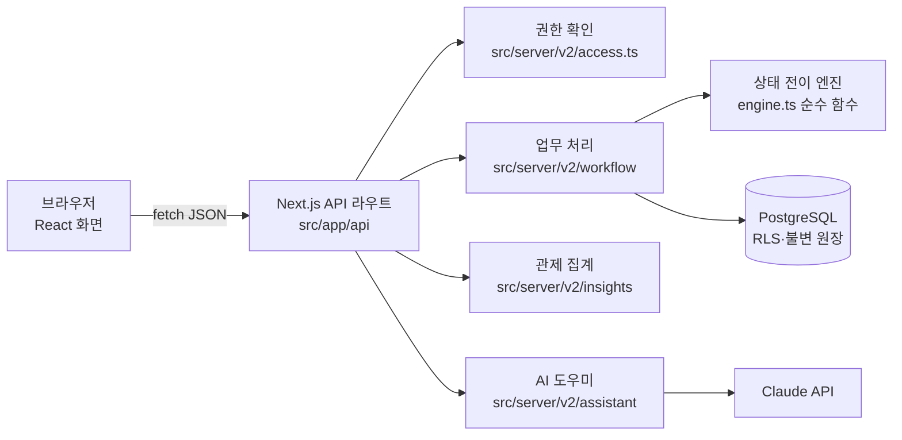
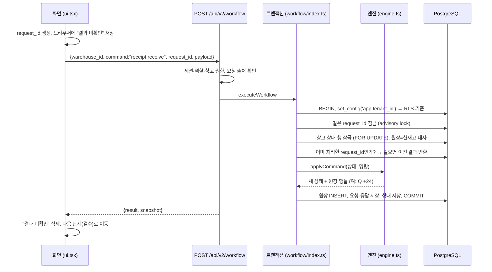

# 02. 시스템 구조

## 1. 큰 그림

- **화면**과 **API**가 한 Next.js 앱에 있습니다. 화면은 `src/app/dashboard/v2`, API는 `src/app/api/v2`.
- **업무 규칙은 서버에만** 있습니다. 화면은 안내만 하고, 수량·권한·상태는 서버가 다시 검사합니다.
- **엔진(engine.ts)은 DB를 모르는 순수 함수**입니다. "현재 상태 + 명령 → 새 상태 + 원장 행"만 계산하므로 단위 테스트가 쉽습니다.

## 2. 버튼 하나를 누르면 — "실물 수령 확정"

각 단계가 무엇을 막는지:

| 단계 | 막는 문제 |
| --- | --- |
| request_id를 먼저 브라우저에 저장 | 응답을 못 받았을 때 "됐나?"를 같은 키로 확인할 수 있음 |
| `set_config('app.tenant_id')` + RLS | 다른 회사 데이터를 조회·수정하는 실수 |
| request_id 잠금 | 같은 요청이 동시에 두 번 들어오는 경우 |
| 창고 상태 행 잠금 | 두 작업자가 같은 재고를 동시에 예약하는 경우 |
| 원장=현재고 대사 | 이미 틀어진 상태 위에 새 작업을 쌓는 경우 |
| request_id 중복 확인 | 재시도로 같은 수량이 두 번 반영되는 경우 |

## 3. 폴더 지도

| 경로 | 역할 |
| --- | --- |
| `src/app/dashboard/v2/ui.tsx` | 현장 운영 화면 틀: 탭, 창고 선택, 명령 전송·복구 |
| `src/app/dashboard/v2/control-ui.tsx` | 운영 관제, 처리량 차트, AI 도우미 |
| `src/app/dashboard/v2/workflow-ui.tsx` | 입고·출고·반품 작업 화면, 스캔·확정 폼(ActionEditor) |
| `src/app/dashboard/v2/inventory-ui.tsx` | 업무 대기열, 재고·실사·승인, 교대 마감 |
| `src/app/api/v2/workflow/route.ts` | 업무 명령 API (조회 GET, 실행 POST) |
| `src/app/api/v2/insights/route.ts` | 관제용 원장 집계 API |
| `src/app/api/v2/assistant/route.ts` | AI 도우미 API |
| `src/server/v2/access.ts` | 역할·창고 권한 확인 |
| `src/server/v2/workflow/engine.ts` | 상태 전이 규칙 (가장 중요한 업무 코드) |
| `src/server/v2/workflow/index.ts` | 트랜잭션, 멱등 처리, 원장 저장, 대사 |
| `src/server/v2/insights/` | 관제 지표·경고·품절 예측·배치도 계산과 집계 SQL |
| `src/server/v2/assistant/` | AI 도우미 도구 정의와 도구 호출 루프 |
| `src/server/db/tenant.ts` | 트랜잭션마다 회사 ID를 DB 세션에 설정 |
| `db/migrations/` | 테이블, 인덱스, RLS 정책, 불변 트리거 |
| `apps/simulator/` | 가상 거래처·주문·운송 사건을 보내는 별도 앱 |

## 4. 데이터 모델 (v2 핵심)

| 테이블 | 내용 | 특징 |
| --- | --- | --- |
| `v2_workflow_state` | 창고별 업무 상태(입고예정·주문·포장·출하 등) | 창고 단위로 잠가서 명령을 한 줄로 세움 |
| `v2_workflow_stock` | 품목×위치별 S·R·P·Q·B 현재고 | 원장 합계와 항상 같아야 함 |
| `v2_workflow_ledger` | 모든 재고 변화 한 줄씩 (품목, 위치, 버킷, 증감, 명령, 작업자, 시각) | **UPDATE·DELETE 금지 트리거** |
| `v2_workflow_requests` | request_id별 요청 해시와 응답 | 재시도 시 같은 응답 반환, 불변 |
| `items`, `locations`, `partners`, ... | 기준정보 | 회사별 RLS |

모든 테이블에 `tenant_id`가 있고, v2 테이블은 `FORCE ROW LEVEL SECURITY`로 테이블 소유자도 정책을 따르게 했습니다. 앱이 쓰는 DB 계정은 `NOBYPASSRLS`라서 정책을 우회할 수 없습니다.

## 5. 역할

| 역할 | 할 수 있는 일 |
| --- | --- |
| 회사 관리자 (admin) | 계정·창고 권한·기준정보·연계 설정 + 승인 |
| 운영 책임자 (supervisor) | 작업 배정, 예외 처리, 승인 (계정 관리 불가) |
| 작업자 (worker) | 수령·검수·적치·피킹·포장·출하·실사 입력 (승인 불가) |
| 조회자 (viewer) | 조회만 |

운영 관제 탭은 관리자·책임자·조회자에게 기본 화면으로, 작업자에게는 업무 대기열이 기본 화면으로 열립니다.

## 스스로 확인

1. 엔진을 DB와 분리한 덕분에 얻는 장점 두 가지는?
2. 화면에서 수량 검사를 했는데 서버에서 또 검사하는 이유는?
3. 같은 창고에서 두 작업자가 동시에 "예약"을 누르면 어떤 순서로 처리되나요?
4. 다른 회사 데이터가 보이지 않게 막는 장치를 두 겹 이상 말해 보세요.
