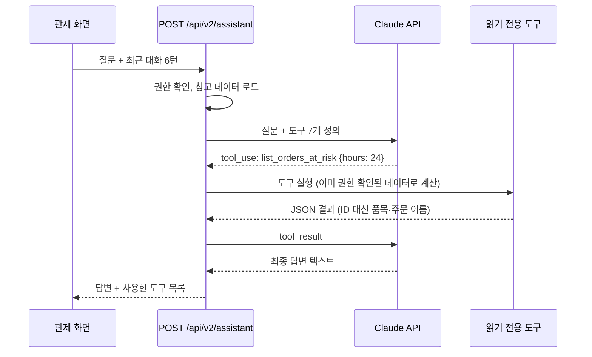

# 04. 운영 관제와 AI 기능

## 1. 운영 관제가 보여주는 것

오퍼레이터(관리자·책임자)가 처음 여는 화면입니다. 화면은 `src/app/dashboard/v2/control-ui.tsx`, 계산은 `src/server/v2/insights/analytics.ts`(순수 함수)에 있습니다.

| 영역 | 계산 방법 | 데이터 출처 |
| --- | --- | --- |
| KPI 8개 | 진행 중 입고·입고 지연·진행 중 주문·오늘 납기·납기 초과·승인 대기·보류 수량·재고 대사 | 업무 상태 스냅샷 |
| 조치 필요 | 대사 불일치 → 납기 초과·4시간 이내 → 품절 임박 → 입고 지연 → 승인 대기 → 예약 차단 위치, 심각도 순 | 스냅샷 + 품절 예측 |
| 오늘 처리량 | 오늘(한국 시간) 원장의 실물 이동을 시간대·흐름별로 합산 | 원장 집계 API |
| 납기 위험 주문 | 24시간 안에 납기인 미출하 주문, 남은 시간 순 | 스냅샷 |
| 품절 예측 | 아래 3절 | 원장 집계 + 현재고 |
| 창고 배치도 | 위치를 구역(수령·보관·피킹·출하·보류)별로 묶고 상태를 색으로 | 기준정보 + 현재고 + 실사 잠금 |

**왜 계산을 순수 함수로 분리했나?** 같은 계산을 화면(관제)과 AI 도구가 함께 쓰고, DB 없이 단위 테스트할 수 있기 때문입니다(`tests/unit/v2-insights.test.ts`).

## 2. 원장 집계 SQL (`src/server/v2/insights/index.ts`)

원장의 한 줄은 "어떤 명령이 어떤 버킷을 얼마나 바꿨나"입니다. 이 줄들을 **실물 흐름**으로 분류합니다.

| 흐름 | 조건 |
| --- | --- |
| 입고 수령 | `receipt.receive`·`return.receive`이고 Q 또는 B가 증가 |
| 적치 | `*.putaway`이고 S가 증가 |
| 피킹 | `order.pick`이고 P가 증가 |
| 출하 | `shipment.create`이고 P가 감소 |

```sql
SELECT extract(hour FROM created_at AT TIME ZONE 'Asia/Seoul')::int AS hour,
       <흐름 CASE> AS flow, sum(abs(delta)) AS quantity
FROM v2_workflow_ledger
WHERE tenant_id=$1 AND warehouse_id=$2
  AND created_at >= (오늘 0시, 한국 시간)
GROUP BY 1, 2
```

- `(tenant_id, warehouse_id, created_at)` 인덱스가 이미 있어서 기간 집계가 빠릅니다. 새 마이그레이션이 필요 없었습니다.
- 날짜는 서버 시간대가 아니라 **한국 영업일** 기준으로 자릅니다.
- 화면 스냅샷의 원장은 최근 100줄뿐이라 예측에는 부족해서, 집계 API를 따로 만들었습니다.

## 3. 품절 예측 알고리즘

출하 원장만 수요로 봅니다(입고·내부 이동은 수요가 아님).

```
최근7일평균 = 최근 7일 출하 합계 / 7
28일평균   = 28일 출하 합계 / 28
하루 소진량 = 0.6 × 최근7일평균 + 0.4 × 28일평균
남은 일수   = 가용재고(A) / 하루 소진량
권장 발주   = max(0, 올림(하루 소진량 × (조달 3일 + 안전재고 14일) − 가용재고))
위험       = 남은 일수 ≤ 3 → 긴급, ≤ 10 → 주의, 그 외 → 여유, 출하 없음 → 대상 아님
```

**손으로 계산해 보기** — 오늘 70개, 20일 전 70개 출하, 가용 30개:

- 최근7일평균 = 70 / 7 = 10
- 28일평균 = 140 / 28 = 5
- 하루 소진량 = 0.6×10 + 0.4×5 = **8**
- 남은 일수 = 30 / 8 = **3.75 → 3.7일** (소수 첫째 자리 내림) → 주의
- 권장 발주 = 올림(8 × 17 − 30) = **106 EA**

(이 예제는 `tests/unit/v2-insights.test.ts`에 그대로 들어 있습니다.)

**왜 이 방식인가?** 설명하기 쉽고, 최근 급증을 반영하면서 하루 튀는 값에 휘둘리지 않습니다. **한계**: 계절성·요일 패턴·프로모션을 모르고, 출하가 없던 신규 품목은 예측하지 못합니다. 개선한다면 요일별 계수, 지수평활(ETS), 공급처별 실제 조달 기간을 넣을 수 있습니다. 면접에서 한계를 먼저 말하면 오히려 신뢰를 얻습니다.

## 4. AI 운영 도우미

### 구조



### 도구 7개 (`src/server/v2/assistant/tools.ts`)

| 도구 | 하는 일 |
| --- | --- |
| `get_operations_overview` | 현황 숫자와 경고 목록 |
| `list_orders_at_risk` | N시간 안에 납기인 미출하 주문 |
| `find_item_stock` | 품목 코드·이름으로 위치별 재고 |
| `list_open_receipts` | 진행 중 입고(지연만 보기 가능) |
| `list_pending_approvals` | 승인 대기 |
| `forecast_stockouts` | 품절 예측 |
| `get_today_throughput` | 오늘 시간대별 처리량과 작업자별 실적 |

### 설계 포인트

- **도구 호출 루프** (`src/server/v2/assistant/index.ts`): AI가 `tool_use`로 멈추면 도구를 실행하고, 결과를 **한 번의 user 메시지**에 모두 담아 다시 보냅니다. 최대 6회 반복합니다.
- **strict 스키마**: 도구 입력에 `additionalProperties: false`와 `strict: true`를 걸어, 정의하지 않은 입력이 들어오지 않게 했습니다.
- **모델**: `claude-opus-5-5`, `effort: low`(대화형 조회는 깊은 추론보다 응답 속도가 중요), 안전 분류기가 거절하면 서버가 대체 모델로 다시 실행하도록 `fallbacks: "default"`를 켰습니다.
- **대화 기록**: 이전 대화는 새 질문 안에 짧은 대화록으로 넣습니다. 요청마다 새 대화라서 서버에 상태를 저장하지 않습니다. 공용 단말에서 다음 사람에게 대화가 남지 않도록 화면 메모리에만 둡니다.
- **키가 없을 때**: `ANTHROPIC_API_KEY`가 없으면 `ASSISTANT_UNCONFIGURED`를 돌려주고, 화면은 빠른 질문을 같은 도구로 **직접 실행**해서 한국어 문장으로 바꿔 보여줍니다(`summarize`). 데모가 키 없이도 동작합니다.
- **오류 처리**: SDK의 오류 종류별로 나눠 처리합니다(인증 → 미설정, 속도 제한 → 잠시 후 재시도, 그 외 → 연결 불가).

### 테스트

- `tests/unit/v2-assistant.test.ts`: 가짜 AI 클라이언트로 "도구 2개 요청 → 결과 한 메시지로 반환 → 최종 답변", 거절 처리, 반복 한도를 검사합니다. 실제 API를 부르지 않으므로 비용이 들지 않습니다.
- `tests/e2e/v2-control.spec.ts`: 실제 DB에 입고·출하를 만든 뒤 관제 숫자, 차트, 품절 예측, 키 없는 빠른 질문 답변을 브라우저로 확인합니다.

## 5. 더 발전시킨다면 (면접 답변용)

1. **알림 푸시**: 납기 위험·품절 임박을 슬랙·문자로 보내기 (지금은 화면에서만 표시)
2. **예측 고도화**: 요일 계수, 공급처별 조달 기간, 예측 정확도 추적(예측 vs 실제)
3. **AI 쓰기 기능**: 지금은 조회만. 넣는다면 "AI가 제안 → 사람이 확인 버튼으로 확정" 구조로, 기존 승인 분리 규칙을 그대로 태움
4. **디지털 트윈**: 배치도에 실제 좌표·선반 높이를 넣고 피킹 동선 시각화
5. **TMS 연동**: 출하 후 배차·운행 추적 (쿨스 TMS·셔틀킹 영역과 연결)

## 스스로 확인

1. 품절 예측에서 입고 원장을 수요로 세지 않는 이유는?
2. 위 예제에서 가용이 30이 아니라 0이면 위험 등급과 권장 발주는?
3. AI가 존재하지 않는 도구 이름을 부르면 어떻게 되나요?
4. 도구 결과를 여러 user 메시지로 나눠 보내면 어떤 문제가 있나요?
5. AI 키가 없을 때도 빠른 질문이 동작하는 원리는?
